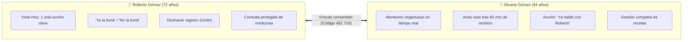

# 💊 MediRecord · Sistema Inteligente de Adherencia Farmacológica y Acompañamiento Familiar

> **Prototipo Interactivo de Alta Fidelidad Mobile-First** diseñado para optimizar el cumplimiento de tratamientos médicos en **adultos mayores** y brindar tranquilidad activa a sus **familiares cuidadores**, preservando en todo momento la autonomía, la dignidad y la privacidad del paciente.

[](https://react.dev/)
[](https://www.typescriptlang.org/)
[](https://vitejs.dev/)
[](https://www.w3.org/WAI/standards-guidelines/wcag/)
[](https://vercel.com/)
[](#)

---

## 📑 Tabla de Contenidos

1. [Visión del Proyecto y Fundamentación Ética](#-visión-del-proyecto-y-fundamentación-ética)
2. [Proto-Personas y Modelos de Interacción](#-proto-personas-y-modelos-de-interacción)
   - [Roberto Gómez (72 años, Paciente Mayor)](#-roberto-gómez-72-años-paciente-mayor)
   - [Silvana Gómez (44 años, Familiar Cuidadora)](#-silvana-gómez-44-años-familiar-cuidadora)
3. [Decisiones Clave de UX y Accesibilidad (a11y)](#-decisiones-clave-de-ux-y-accesibilidad-a11y)
4. [Diseño Mobile-First y Responsividad Adaptativa](#-diseño-mobile-first-y-responsividad-adaptativa)
5. [Centro de Control de Demostración & Escenarios E2E](#-centro-de-control-de-demostración--escenarios-e2e)
6. [Stack Tecnológico y Arquitectura de Software](#-stack-tecnológico-y-arquitectura-de-software)
7. [Estructura del Proyecto](#-estructura-del-proyecto)
8. [Guía de Ejecución Local y Despliegue en Vercel](#-guía-de-ejecución-local-y-despliegue-en-vercel)
9. [Criterios de Evaluación y Valor Académico](#-criterios-de-evaluación-y-valor-académico)

---

## 🌟 Visión del Proyecto y Fundamentación Ética

El olvido y la administración inadecuada de medicamentos constituyen uno de los problemas sanitarios y psicosociales más críticos en la población de adultos mayores con patologías crónicas (hipertensión, diabetes tipo 2, artrosis, entre otras). Con frecuencia, las soluciones digitales del mercado cometen dos errores antagónicos:

1. **Infantilización y pérdida de privacidad**: Convierten al paciente en un sujeto bajo vigilancia continua, llenando el teléfono de sus familiares con notificaciones por cada acción cotidiana, lo que genera fricción familiar, ansiedad y resistencia al uso.
2. **Complejidad cognitiva excesiva**: Interfaces abarrotadas de opciones, menús laberínticos, tipografías minúsculas, botones táctiles reducidos y una carencia casi total de mecanismos de tolerancia a fallos.

### El Axioma Fundamental de MediRecord

> [!IMPORTANT]
> **«No confirmar no significa no tomar.»**  
> En MediRecord, si un paciente no marca su toma a la hora exacta, el sistema **no asume** negligencia ni dispara alertas de emergencia injustificadas. Otorga un margen de tolerancia respetuoso (umbral de 60 minutos por defecto), permitiendo que la persona complete su rutina sin sentirse perseguida ni juzgada.

### Pilares de Diseño Ético

```
┌──────────────────────────────────────────────────────────────────────────┐
│                           FILOSOFÍA MEDIRECORD                          │
├───────────────────────────────┬──────────────────────────────────────────┤
│ Cuidado sin Vigilancia        │ Monitoreo pasivo respetuoso: la familiar │
│ Invasiva                      │ solo es notificada ante retrasos reales. │
├───────────────────────────────┼──────────────────────────────────────────┤
│ Autonomía sin Desamparo       │ El paciente tiene control total; cuenta  │
│                               │ con un vínculo familiar para respaldo.   │
├───────────────────────────────┼──────────────────────────────────────────┤
│ Rigor Clínico Contextual      │ Se registran motivos de omisión médica   │
│                               │ ("Me sentí mal", "Me olvidé").           │
├───────────────────────────────┼──────────────────────────────────────────┤
│ Tolerancia a Errores          │ Capacidad universal de «Deshacer (Undo)» │
│                               │ y protección ante borrados accidentales. │
└───────────────────────────────┴──────────────────────────────────────────┘
```

---

## 👥 Proto-Personas y Modelos de Interacción

MediRecord implementa un **doble recorrido de usuario simbiótico**, donde cada rol cuenta con un lenguaje visual, densidad de información y conjunto de herramientas perfectamente adaptados a sus capacidades y responsabilidades.



---

### 👴 Roberto Gómez (72 años, Paciente Mayor)

* **Contexto vital**: Jubilado, vive solo en su departamento. Administra tres medicamentos diarios: Losartán (08:00) y Metformina (14:00 y 20:00).
* **Desafíos**: Presbicia moderada, disminución leve de la motricidad fina en dedos, temor a apretar opciones incorrectas y borrar sus recetas por error.
* **Experiencia diseñada para Roberto**:
  * **Pantalla «Hoy» de extrema claridad**: Una tarjeta principal con la dosis en curso («Ahora te toca: Metformina 14:00»), horario legible en cápsula destacada y progreso diario general («1 de 3 tomas registradas»).
  * **Botón principal «Ya la tomé»**: Altura mínima de 54px, borde redondeado, contraste óptimo y confirmación instantánea.
  * **Confirmación accesible «No la tomé» con registro médico**: Lejos de ocultar la omisión por vergüenza, Roberto puede comunicar de forma sincera por qué no tomó la medicación (*«Me sentí mal»*, *«Me olvidé»*, *«Otro motivo»*). Silvana recibe este dato de inmediato, aportando información clínica valiosa para el médico tratante.
  * **Mecanismo de Deshacer («Undo»)**: Si Roberto presionó un botón por accidente o de manera apresurada, la tarjeta le ofrece un botón claro y directo: *«¿Fue un error? Deshacer registro»*, retornando la dosis al estado pendiente sin penalizaciones ni desconfiguraciones.
  * **Posponer 10 minutos**: Si la alarma suena en un momento inoportuno (ej. atendiendo la puerta), Roberto puede aplazar el aviso 10 minutos con un toque.
  * **Consulta protegida de medicinas**: Roberto puede consultar la lista de sus medicamentos prescritos, pero **no tiene botones rápidos de eliminación o desconfiguración** en las listas para evitar borrados accidentales involuntarios.
  * **Historial simplificado**: Agrupado cronológicamente con estados explícitos (*Confirmadas*, *Sin confirmar*, *No tomadas* con motivo).
  * **Ajustes de accesibilidad integrados**: Selector de tamaño tipográfico dinámico, modo alto contraste y prueba de avisos sonoros claros.

---

### 👩 Silvana Gómez (44 años, Familiar Cuidadora)

* **Contexto vital**: Hija de Roberto, trabaja a tiempo completo en oficina y cuida de sus propios hijos. Su mayor preocupación es que su padre olvide su medicación para la diabetes o la presión.
* **Desafíos**: Carga mental elevada; no dispone de tiempo para llamarlo a cada hora del día ni desea incomodarlo haciéndolo sentir vigilado.
* **Experiencia diseñada para Silvana**:
  * **Monitoreo respetuoso en tiempo real**: Silvana **NO recibe alertas ni llamadas de atención ante tomas normales**. La pantalla de resumen le muestra discretamente el progreso del día.
  * **Aviso de omisión tras el umbral de espera (60 min)**: Solo si pasan 60 minutos (umbral configurable: 30, 60 o 90 minutos) sin que Roberto confirme la dosis de las 14:00, Silvana recibe un aviso claro: *«Roberto no confirmó: Metformina 14:00»*.
  * **Acción de acompañamiento «Ya hablé con Roberto»**: Silvana puede tocar el botón de llamada directa. Al comunicarse con su padre y saber que está bien, presiona *«Ya hablé con Roberto»*. Esta acción **da por atendido el aviso en el panel de Silvana**, pero **NO falsea el registro médico**: la toma sigue figurando como «sin confirmar» hasta que Roberto la registre en su propio dispositivo, respetando la veracidad de la historia clínica.
  * **Gestión y administración de recetas**: Silvana puede cargar nuevos fármacos a través de un **asistente guiado de 4 pasos** (Nombre del fármaco, Dosis y concentración, Frecuencia y horarios, Confirmación), editar horarios y pausar o retirar medicamentos mediante confirmaciones modales de seguridad.
  * **Código familiar seguro (482 716)**: Generación de credencial de vinculación de 6 dígitos con solicitud explícita de consentimiento para Roberto.

---

## ♿ Decisiones Clave de UX y Accesibilidad (a11y)

El diseño de MediRecord fue concebido bajo los lineamientos internacionales de la **W3C / Web Content Accessibility Guidelines (WCAG 2.1)** en niveles **AA** y **AAA**:

```
┌─────────────────────────────────────────────────────────────────────────────┐
│                    MATRIZ DE ACCESIBILIDAD Y USABILIDAD                     │
├──────────────────────────┬──────────────────────────────────────────────────┤
│ Escalado Tipográfico     │ Sistema de 3 niveles proporcionales:             │
│ Dinámico                 │ • Normal: 15px base (Títulos 20px - 24px)        │
│                          │ • Grande: 18px base (Títulos 26px - 29px)        │
│                          │ • Muy Grande: 21px base (Títulos 32px - 37px)    │
│                          │ Escalado armónico sin rotura de contenedor ni     │
│                          │ superposición gracias a overflow-wrap y safe gap.│
├──────────────────────────┼──────────────────────────────────────────────────┤
│ Modo Alto Contraste      │ Refuerza relaciones de luminancia: fondos claros │
│ (WCAG AAA)               │ (#D6E8DF / #FFFFFF), bordes nítidos (#153E3A) y  │
│                          │ textos en negro profundo (#000000 / #222222).    │
├──────────────────────────┼──────────────────────────────────────────────────┤
│ Prevención de Borrado    │ Cero botones destructivos expuestos en listas.   │
│ Accidental               │ Pausa y eliminación quedan resguardadas dentro   │
│                          │ de la vista de detalle con modales de confirmación│
├──────────────────────────┼──────────────────────────────────────────────────┤
│ Modales Centrados con    │ Modales emergentes con elevación, backdrop blur  │
│ Elevación y Backdrop     │ (4px) y animación suave (scaleModal), mitigando   │
│                          │ la incomodidad ergonómica de bottom-sheets.      │
├──────────────────────────┼──────────────────────────────────────────────────┤
│ Dianas de Toque Amplias  │ Todos los elementos interactivos superan la      │
│ (Touch Targets ≥ 48px)   │ recomendación mínima de 48×48px con paddings     │
│                          │ confortables y radio de borde tipo píldora.      │
├──────────────────────────┼──────────────────────────────────────────────────┤
│ Barra de Navegación      │ Contraste tipográfico activo reforzado (#37534D) │
│ Inferior Inclusiva       │ con etiquetas de 13px a 15px y espaciadores      │
│                          │ dinámicos de desplazamiento inferior (padding).  │
└──────────────────────────┴──────────────────────────────────────────────────┘
```

---

## 📱 Diseño Mobile-First y Responsividad Adaptativa

MediRecord implementa una arquitectura híbrida de visualización pensada tanto para el usuario final en su teléfono como para el docente o evaluador en un entorno de aula o defensa de tesis:

### 1. Experiencia en Teléfonos Móviles y Emuladores (`≤ 640px`)
* **100% Full-Bleed Fluido**: La aplicación ocupa la totalidad del viewport (`100dvh`), sin bordes artificiales, marcos simulados ni sombras innecesarias.
* **Respeto a Áreas Seguras (`Safe Areas`)**: Integración de `env(safe-area-inset-top)` y `env(safe-area-inset-bottom)` para respetar notch, islas dinámicas y barras gestuales del sistema operativo móvil.

### 2. Experiencia en Computadoras de Escritorio y Proyectores (`> 640px`)
* **Marco de Smartphone Moderno**: El prototipo se enmarca en un dispositivo centrado de dimensiones modernas (referencia **iPhone 16 Pro Max**, ancho de ~440px y alto responsivo con radio de curvatura de 44px).
* **Barra de Estado Nativa**: Muestra hora de contexto (`14:00`), estado de red Wi-Fi, cobertura celular y batería.
* **Fondo Ambiental Inmersivo**: Gradiente radial oscuro (`#263631` a `#151D1A`) que resalta la interfaz móvil en pantallas grandes y proyectores universitarios sin encandilar a la audiencia.

---

## 🎛️ Centro de Control de Demostración & Escenarios E2E

Para garantizar defensas de tesis, evaluaciones de cátedra y exposiciones orales en vivo 100% fluidas, la aplicación integra un **Centro de Demostración & Pruebas E2E** flotante en la parte inferior, estructurado en **3 pestañas operativas**:

```
┌────────────────────────────────────────────────────────────────────────┐
│             CENTRO DE DEMOSTRACIÓN & PRUEBAS E2E (MEDIRECORD)          │
├────────────────────────────────────────────────────────────────────────┤
│  [ ▶️ 1. Escenarios E2E ]   [ 📱 2. Explorador ]   [ ⚙️ 3. Simulador ] │
├────────────────────────────────────────────────────────────────────────┤
│  • Escenarios E2E: Ejecución automatizada con 1 clic de flujos clave   │
│  • Explorador: Acceso directo a todas las pantallas, vistas y modales  │
│  • Simulador: Modificación granular de tomas, roles y vínculos         │
│  • Acciones globales: [ 🔄 Reiniciar Demo ] [ ⬆️/⬇️ Colapsar/Expandir ] │
└────────────────────────────────────────────────────────────────────────┘
```

### 1. Pestaña «▶️ Escenarios E2E» (Automatización con 1 Clic)
Permite a los evaluadores reproducir instantáneamente historias de usuario completas con retroalimentación visual inmediata vía toasts:
* **Escenario 1 (Toma puntual confirmada)**: Simula a Roberto registrando su toma a las 14:02. Silvana NO recibe avisos molestos (respeto estricto a la autonomía).
* **Escenario 2 (Omisión con motivo médico)**: Roberto indica que no tomó Metformina seleccionando el motivo clínico *«Me sentí mal»*. Silvana recibe de inmediato una alerta contextual con dicho motivo.
* **Escenario 3 (Olvido crítico tras 60 minutos)**: Transcurre el umbral de espera sin confirmación. Silvana recibe la alerta para llamar o intervenir sin juzgar.
* **Escenario 4 (Capacidad de Deshacer - Undo)**: Se confirma la toma y se destaca el botón *«¿Fue un error? Deshacer registro»*, demostrando la tolerancia a fallos involuntarios.
* **Escenario 5 (Invitación familiar pendiente)**: Silvana emite la invitación con el código `482 716` y Roberto visualiza el banner contextual para evaluar permisos y aceptar.
* **Escenario 6 (Accesibilidad visual para adulto mayor)**: Activa en vivo la tipografía «Muy Grande» (21px) y el modo «Alto Contraste», evidenciando que el layout no se quiebra ni superpone texto.

### 2. Pestaña «📱 Explorador de Pantallas» (Navegación Rápida)
Permite saltar de inmediato a cualquier pantalla del flujo sin tener que recorrer pasos intermedios:
* **Vistas de Roberto**: Hoy (tomas del día), Medicinas (consulta protegida), Historial (registro semanal), Ajustes (accesibilidad y sonido).
* **Vistas de Silvana**: Resumen (monitoreo en tiempo real), Medicinas (gestión y asistente de 4 pasos), Historial (auditoría), Ajustes (umbrales de alerta).
* **Modales y Flujos Clave**: Modal de omisión médica, Modal de invitación recibida, Recorrido guiado de vinculación bilateral con código de 6 dígitos (`482 716`), Pantalla de bienvenida y selección de rol.

### 3. Pestaña «⚙️ Simulador de Estados»
Permite alterar variables individuales de forma granular:
* **Usuario Activo**: Alternancia instantánea entre 👴 Roberto (Paciente mayor) y 👩 Silvana (Familiar cuidadora).
* **Toma de las 14:00 (Metformina)**: `⏳ Pendiente` → `✅ Ya la tomé` → `❌ No la tomé` → `⚠️ Sin confirmar (60 min)`.
* **Vínculo Familiar**: `🤝 Vinculados` ↔ `📩 Invitación pendiente` ↔ `🚫 Sin vincular`.
* **Reinicio de Fábrica (`🔄 Reiniciar Demo`)**: Borra la caché de `localStorage` y devuelve el prototipo al estado base en 1 clic.

---

### Matriz de Casos de Uso y Escenarios E2E para Presentaciones

| # | Escenario Evaluado | Acción en el Panel de Control | Comportamiento en Modo Roberto | Comportamiento en Modo Silvana |
|---|--------------------|--------------------------------|--------------------------------|--------------------------------|
| **1** | **Toma a tiempo normal** | Clic en `✅ Ya la tomé` | Tarjeta verde menta con confirmación a las 14:02. Progreso: «2 de 3». Botón «Deshacer». | Resumen muestra «2 de 3 tomas confirmadas». Sin alertas ni avisos molestos. |
| **2** | **Omisión por motivo médico** | Clic en `❌ No la tomé` | Modal de motivo médico (*«Me sentí mal»*). Tarjeta coral de omisión informada. | Alerta roja en Silvana con el motivo exacto: «Roberto indicó que no la tomó: Me sentí mal». |
| **3** | **Retraso crítico (60 min)** | Clic en `⚠️ Sin confirmar` | Tarjeta ámbar: *«Esta toma sigue sin confirmar. Aviso enviado a Silvana a las 15:00»*. | Alerta ámbar: *«Roberto no confirmó»*. Botones: `Llamar a Roberto` y `Ya hablé con Roberto`. |
| **4** | **Atención del aviso sin falsear** | En Silvana: Clic en `Ya hablé con Roberto` | La toma sigue sin confirmar para Roberto; él puede tomarla con retraso. | El aviso pasa a estado "Atendido a las 15:10". La historia clínica permanece íntegra. |
| **5** | **Deshacer error táctil** | Clic en `¿Fue un error? Deshacer` | La dosis vuelve al estado `⏳ Pendiente` de inmediato. | El resumen se actualiza en tiempo real vía Context API. |
| **6** | **Vinculación familiar bilateral** | Clic en `Ver recorrido de Invitación` | Roberto recibe invitación, valida los permisos y confirma el vínculo con Silvana. | Silvana comparte el código `482 716` y visualiza la confirmación de Roberto. |
| **7** | **Ajustes de accesibilidad en vivo** | Ajustes > A tu manera | Modificación en caliente de tamaño (Normal / Grande / Muy Grande) y Alto Contraste. | Los cambios se reflejan al instante en todo el árbol de componentes. |
| **8** | **Reinicio completo de demo** | Clic en `🔄 Reiniciar demo` | Limpieza de `localStorage` y restauración de los datos iniciales de prueba en 1 clic. | Estado base unificado listo para una nueva presentación. |

---

## 💻 Stack Tecnológico y Arquitectura de Software

MediRecord fue desarrollado bajo las mejores prácticas modernas del ecosistema TypeScript/React, priorizando la ausencia de dependencias externas pesadas para garantizar un rendimiento instantáneo (0ms de latencia en transiciones) y un bundle ultra ligero.

```
                               ┌─────────────────────────┐
                               │       index.html        │
                               └────────────┬────────────┘
                                            │
                               ┌────────────▼────────────┐
                               │   MediRecordProvider    │
                               │  (Estado Global React)  │
                               └────────────┬────────────┘
                 ┌──────────────────────────┴──────────────────────────┐
                 │                                                     │
       ┌─────────▼─────────┐                                 ┌─────────▼─────────┐
       │   PhoneMockup     │                                 │  DemoControlBar   │
       │ (Marco de Celular)│                                 │(Centro de Mando)  │
       └─────────┬─────────┘                                 └───────────────────┘
                 ├──────────────────────────────┐
       ┌─────────▼─────────┐          ┌─────────▼─────────┐
       │   Modo Roberto    │          │   Modo Silvana    │
       │(Hoy, Meds, Hist,  │          │(Resumen, Meds,    │
       │     Ajustes)      │          │  Hist, Ajustes)   │
       └───────────────────┘          └───────────────────┘
```

### Tecnologías Empleadas

* **React 19 / 18 (`react`, `react-dom`)**: Arquitectura funcional orientada a hooks (`useState`, `useEffect`, `useContext`, `useMemo`).
* **TypeScript 6.0**: Tipado estático riguroso de entidades médicas, estados de tomas, roles y preferencias de accesibilidad en `src/types.ts`.
* **Vite 8.3**: Empaquetador y entorno de desarrollo con Hot Module Replacement (HMR) instantáneo y optimización de assets.
* **Lucide React**: Iconografía vectorial accesible con atributos semánticos.
* **Context API & Persistencia Reactiva**: Estado centralizado sincronizado automáticamente con `localStorage` (`medirecord_demo_state_v1`).
* **Soporte para Deep-Linking URL**: Permite abrir directamente estados predefinidos para exposiciones académicas:
  * `/?role=roberto`: Inicia directamente en la vista del paciente.
  * `/?role=silvana`: Inicia en la vista de la cuidadora.
  * `/?role=silvana&status=unconfirmed`: Carga directamente la alerta de los 60 minutos sin confirmar.
  * `/?tab=medicinas`: Navega a la gestión de fármacos.
  * `/?tab=historial`: Abre el registro histórico.

---

## 📂 Estructura del Proyecto

```
MediRecord-main/
├── design-reference/              # Especificaciones y vectores Figma de referencia
│   ├── H  Menús principales.svg
│   ├── I  Carga inicial.svg
│   ├── J  Alarma y confirmación.svg
│   ├── K  Aviso de omisión.svg
│   ├── L  Vínculo y casos borde.svg
│   └── M · Decisiones del MVP y registro de cambios.png
├── public/                        # Recursos estáticos y favicons
├── src/
│   ├── assets/                    # Imágenes y assets vectoriales
│   ├── components/                # Componentes modulares de interfaz
│   │   ├── common/                # Vistas y modales compartidos
│   │   │   ├── AccessibilitySettingsView.tsx    # Configuración accesible
│   │   │   ├── FamilyLinkWalkthroughModal.tsx  # Recorrido guiado (482 716)
│   │   │   ├── MedicineManager.tsx              # CRUD seguro de medicinas
│   │   │   ├── RobertoAccessFlow.tsx            # Onboarding de Roberto
│   │   │   ├── RoleSelectionView.tsx            # Pantalla inicial de roles
│   │   │   └── SilvanaAccessFlow.tsx            # Onboarding de Silvana
│   │   ├── roberto/               # Pantallas del Paciente Mayor
│   │   │   ├── InvitationReceivedScreen.tsx     # Aceptación de vínculo
│   │   │   ├── OmissionModal.tsx                # Registro de motivos médicos
│   │   │   ├── RobertoAjustesTab.tsx            # Menú de configuración
│   │   │   ├── RobertoHistorialTab.tsx          # Historial semanal
│   │   │   ├── RobertoHoyTab.tsx                # Pantalla principal core
│   │   │   └── RobertoMedicinasTab.tsx          # Consulta protegida
│   │   ├── silvana/               # Pantallas de la Familiar Cuidadora
│   │   │   ├── SilvanaAjustesTab.tsx            # Preferencias y umbrales
│   │   │   ├── SilvanaHistorialTab.tsx          # Historial supervisado
│   │   │   ├── SilvanaMedicinasTab.tsx          # Asistente de carga I-02/I-05
│   │   │   └── SilvanaResumenTab.tsx            # Monitoreo y avisos K-01/K-05
│   │   ├── BottomNavBar.tsx       # Barra de navegación accesible
│   │   ├── DemoControlBar.tsx     # Centro de control flotante para demo
│   │   ├── PhoneMockup.tsx        # Contenedor responsivo con barra nativa
│   │   └── ToastList.tsx          # Notificaciones flotantes in-app
│   ├── context/
│   │   └── MediRecordContext.tsx  # Estado global, persistencia y eventos
│   ├── data/
│   │   └── initialData.ts         # Datos de prueba (Losartán, Metformina)
│   ├── App.tsx                    # Orquestador principal de la aplicación
│   ├── index.css                  # Design Tokens, tipografía y accesibilidad
│   ├── main.tsx                   # Punto de entrada Vite/React
│   └── types.ts                   # Interfaces y tipos TypeScript
├── index.html                     # Plantilla HTML con viewport mobile optimizado
├── package.json                   # Dependencias y scripts de construcción
├── tsconfig.json                  # Configuración de compilación TypeScript
├── vercel.json                    # Reglas de reescritura para Single Page App
└── vite.config.ts                 # Configuración del bundler Vite
```

---

## 🚀 Guía de Ejecución Local y Despliegue en Vercel

### Requisitos Previos
* **Node.js**: Versión 18.0.0 o superior (recomendado Node 20 LTS o superior).
* **Gestor de paquetes**: `npm` (incluido con Node), `pnpm` o `yarn`.

### Instalación y Ejecución en Desarrollo

```bash
# 1. Clonar el repositorio (o posicionarse en la carpeta raíz)
cd /ruta/hacia/MediRecord-main

# 2. Instalar todas las dependencias del proyecto
npm install

# 3. Iniciar el servidor local de desarrollo con HMR
npm run dev
```

El servidor quedará disponible de inmediato en `http://localhost:5173` (o el puerto indicado por la terminal).

### Compilación para Producción y Verificación

```bash
# Ejecutar verificación de tipos TypeScript y compilar bundle para producción
npm run build

# Probar localmente el build compilado en modo vista previa (preview)
npm run preview
```

### ☁️ Despliegue en Vercel en 2 Pasos

El repositorio incluye un archivo [`vercel.json`](file:///home/augusto/Documents/Proyectos/MediRecord-main/vercel.json) preconfigurado con reescrituras de rutas para navegación SPA limpia sin errores 404:

1. **Vincular repositorio**: Importa este repositorio en tu cuenta de [Vercel](https://vercel.com).
2. **Auto-detección**: Vercel detectará automáticamente el framework **Vite**:
   * **Build Command**: `npm run build`
   * **Output Directory**: `dist`
   * **Install Command**: `npm install`
3. Clic en **Deploy**. En menos de 60 segundos la demo interactiva estará en línea con certificado SSL y CDN global.

---

## 🎓 Criterios de Evaluación y Valor Académico

Este prototipo fue construido con rigor metodológico para cumplir con las exigencias de cátedras y tribunales de evaluación en áreas de:

* **Interacción Humano-Computadora (HCI / IPO)**: Estudio riguroso de interfaces para la tercera edad (*Gerontotecnología*), minimizando la carga cognitiva y respetando modelos mentales preexistentes.
* **Diseño Centrado en las Personas (DCP / UCD)**: Validación de proto-personas, recorridos afectivos y no intrusivos entre familiares.
* **Ingeniería Web y Accesibilidad**: Cumplimiento verificable de los 4 principios de la WCAG (Perceptible, Operable, Comprensible y Robusto).
* **Arquitectura de Software Front-End**: Separación estricta de responsabilidades, estado predecible, inmutabilidad y tipado preventivo contra fallos en tiempo de ejecución.

---

<p align="center">
  <b>MediRecord</b> · Diseñado con respeto y rigurosidad técnica para quienes cuidamos y quienes nos cuidaron.
</p>
